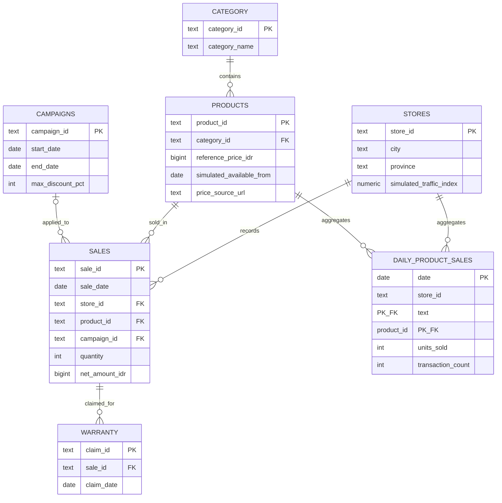

# ERD — Apple Retail Indonesia (Simulasi)

## Granularity

- `sales`: **one simulated retail sale event of a single product**, quantity may be 1–3; `sale_id` unique.
- `daily_product_sales`: **one date × store × product** *within simulated availability*; includes zeros to prevent ML survivorship bias. Primary key (`date`, `store_id`, `product_id`).
- `warranty`: **one claim** linked to a valid sale; many possible claims to a sale, simulation currently <=1.
- `products`: one model/reference base variant, not full SKU inventory by color/storage.
- `stores`: a fictional retail network whose cities and provinces are real Indonesian locations.

Campaigns are conceptual synthetic promotions; only some sales during a campaign have a campaign ID. `campaign_active` means a campaign period exists for that date, not that every sale received a discount.
